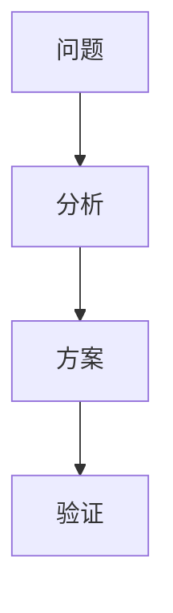

# Rocky Blog 当前 Markdown 能力规范

本文只列出当前代码和 `config/site.yaml` 确认启用的能力。Muse 应优先使用标准 Markdown；扩展语法只有在确实提升理解时才使用。不要从其他主题或旧版 Hexo / Astro Koharu 教程复制未验证语法。

## 1. 标准 Markdown 与 GFM

支持标题、段落、链接、图片、引用、分割线、有序 / 无序列表、表格、任务列表、删除线和自动链接。

```markdown
## 小节

- 要点一
- 要点二

| 项目 | 说明 |
| --- | --- |
| Astro | 静态站点生成器 |
| Pagefind | 静态全文搜索 |

- [x] 已核对
- [ ] 待补充
```

标题从 `##` 开始组织文章主体，避免跳级或仅为视觉效果设置标题。

## 2. 代码块（Shiki）

使用带语言标识的 fenced code block：

````markdown
```ts
interface ArticleMeta {
  title: string;
  slug: string;
}
```
````

只提供可运行或明确标注为伪代码的示例。不要把命令、配置和代码混在无语言标识的代码块里。代码块增强支持复制、全屏及当前配置启用的折叠 / 元数据展示。

## 3. KaTeX 数学公式

当前全局启用了数学公式处理。行内公式使用单美元符号，块级公式使用双美元符号：

```markdown
行内公式：$E = mc^2$

$$
\int_0^1 x^2\,dx = \frac{1}{3}
$$
```

公式需语法正确，并在有必要时设置 `math: true`。不要把普通货币金额误写成公式。

## 4. Mermaid 图表

使用 `mermaid` 代码围栏，图表定义必须是 Mermaid 原生语法：



图表只用于表达流程、关系、时序或结构。节点文字应简洁；图表复杂时拆分，不要将整篇文章塞入图表。

## 5. AntV Infographic

使用 `infographic` 围栏。围栏正文首行声明模板名称，然后使用项目支持的缩进数据语法：

```infographic
infographic list-grid-badge-card
data
  title 内容处理流程
  desc 从源文件到静态页面
  items
    - label Markdown
      desc 文章源文件
      icon mdi/markdown
    - label Astro
      desc 内容校验和静态生成
      icon mdi/rocket-launch
    - label Pagefind
      desc 构建搜索索引
      icon mdi/magnify
```

仅选择与信息类型匹配的模板（如 `list-*`、`sequence-*`、`compare-*`、`hierarchy-*`、`chart-*`、`quadrant-*`、`relation-*`）。图表数字必须来自可核验数据；没有数据时使用定性结构图，禁止编造统计数据。图标标识使用有效的 Material Design Icons 名称。

## 6. Shoka 兼容语法

以下语法由当前 Markdown 管线插件处理，相关开关目前在 `config/site.yaml` 中启用。

### 提醒块（Directives）

```markdown
:::info
背景说明。
:::

:::warning
需要读者特别留意的限制。
:::

:::success
已经由来源或测试证实的结果。
:::
```

可用类型包括 `default`、`primary`、`info`、`success`、`warning`、`danger`；不要为了装饰而滥用。

### 折叠块

```markdown
+++primary 进阶说明
这里放补充解释、细节或可选推导。

- 可包含列表
- 可包含其他 Markdown
+++
```

### 标签页

````markdown
;;;tab1 JavaScript
```js
console.log("Hello");
```
;;;

;;;tab1 Python
```python
print("Hello")
```
;;;
````

标签页标题应简短，内容应相互对应。若内容很短，普通小节比标签页更清晰。

### 文字属性与强调

```markdown
++下划线文字++
++波浪下划线++{.wavy}
==重点高亮==
H~2~O
E = mc^2^
[键盘快捷键]{.kbd}
[重点标签]{.label .primary}
```

颜色类和文本特效仅作少量强调，不要用颜色代替语义。

### Spoiler 与 Ruby 注音

```markdown
点击查看：!!隐藏内容!!
悬停模糊：!!模糊内容!!{.blur}
注音：{漢字^かんじ}
```

Ruby 示例适用于需要注音的中文 / 日文文字。不要在普通中文文章中无意义地添加注音。

## 7. 加密内容（仅在明确授权时）

局部加密块语法：

```markdown
:::encrypted{password="由维护者提供的口令"}
需要加密的正文。
:::
```

全篇加密使用 frontmatter 的 `password` 字段。Muse 不得自行创建口令或将密码写进普通文章。静态加密不能替代服务器鉴权，密文和公开参数会随静态页面交付，可能被离线猜测；不得用于密钥、凭据或敏感个人信息。

## 8. 不应输出的内容

以下不是当前站点文章能力，Muse 不得把它们作为可用组件输出：

- CMS 表单、文章管理面板、登录窗口或后台短代码；
- 评论、友链、社交动态、统计图表 / 访问来源仪表板；
- AI 摘要组件、向量推荐组件、播放列表或全站音乐播放器；
- 未批准的 Quiz、随机推荐、自定义音视频播放器和社交媒体嵌入。

普通外部链接可以用 Markdown 超链接表达，但不要声称它会自动生成第三方嵌入卡片。