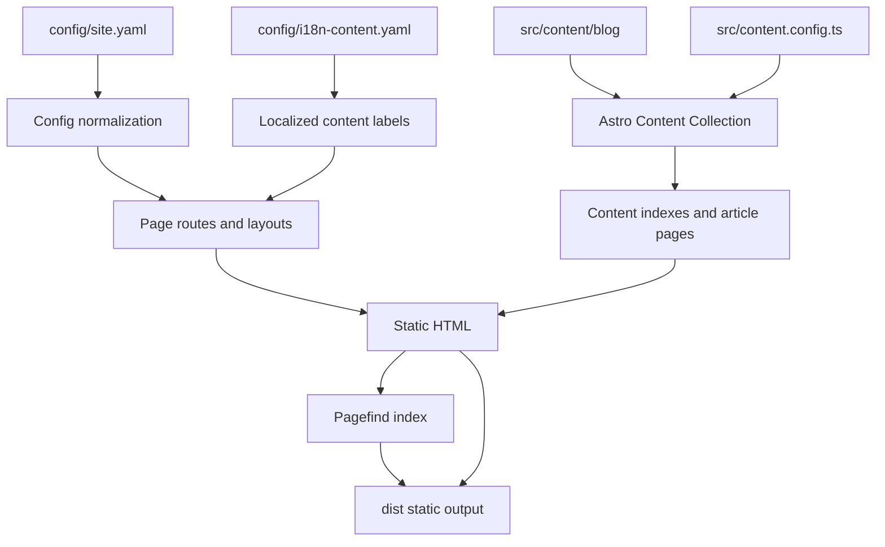

# 01 — 架构与数据流

## 设计原则

Rocky Blog 使用静态优先架构。内容解析、路由生成、SEO 元数据和搜索索引尽可能在构建阶段完成；浏览器只负责必要的阅读交互和偏好持久化。

- Astro 页面和布局负责路由、静态 HTML 与内容组合。
- React 仅用于确实需要客户端状态或复杂交互的组件。
- 配置读取、校验和默认值集中管理。
- 内容 schema 在构建阶段验证。
- 浏览器持久化只存非敏感的体验偏好与阅读状态。
- 避免让静态博客依赖服务端数据库。

## 构建时数据流

## 配置加载

`config/site.yaml` 是站点级配置入口。`src/lib/config/site.ts` 负责 YAML 解析和配置装配；各分区的正规化函数位于 `src/lib/config/`。新增字段时：

1. 检查是否已有同义字段或默认值。
2. 更新对应的类型。
3. 在 section normalizer 中加入默认值和校验。
4. 更新配置样例和文档。
5. 为配置行为增加 node:test 覆盖。

不要在组件中直接解析 YAML。不要从 `src/lib/` 反向导入 `@constants/site-config`。

## 内容加载

`src/content.config.ts` 定义 `blog` collection，使用项目 glob loader 从 `src/content/blog/` 发现内容。Frontmatter 由 Zod schema 验证。发布日期由站点时区工具解析，避免构建机器时区改变文章排序。

文章列表、分类、标签、系列和文章详情应复用 `src/lib/content/` 中的数据选择逻辑，避免各路由重复过滤。

## 页面与交互

Astro 页面输出语义化 HTML。交互式 React 组件通过 hydration 指令挂载。大型依赖应在需要时加载，不要把搜索、图表、灯箱与设置面板都放进首页主 bundle。

Astro ClientRouter 会在站内导航时交换页面内容。监听器、Observer 和订阅必须支持初始化与清理，不能假设每次导航都会完整刷新 document。

## 搜索

Pagefind 索引由构建流程生成，搜索不依赖自建 API。搜索组件消费站点生成的索引和 UI 字典，不要接入云端搜索或 analytics。

## 部署与运行边界

- 输出目录为 `dist/`。
- 交付方式为静态文件托管。
- 当前静态站点构建与托管流程不需要数据库、登录、API server、Docker 或持续运行的 Node 进程。Docker / Docker Compose 是否作为额外交付方式支持仍待维护者决策；不得将当前不需要解释为永久否决，也不得擅自增加容器基础设施。
- 小型交互不应成为引入后端状态的理由。
- 本地阅读历史与偏好不会跨设备同步。

## 目录职责

| 路径 | 职责 |
| --- | --- |
| `src/pages/` | 文件路由与页面生成 |
| `src/layouts/` | 页面布局、Meta、全局壳层 |
| `src/components/` | 可复用 Astro / React UI |
| `src/content/blog/` | Markdown / MDX 内容与译文 |
| `src/lib/` | 内容、配置、加密、搜索等逻辑 |
| `src/store/` | Nanostores 与浏览器状态 |
| `src/i18n/` | UI 字典与语言工具 |
| `src/styles/` | 全局、主题、Markdown 和模块样式 |
| `config/` | 站点级 YAML 配置 |
